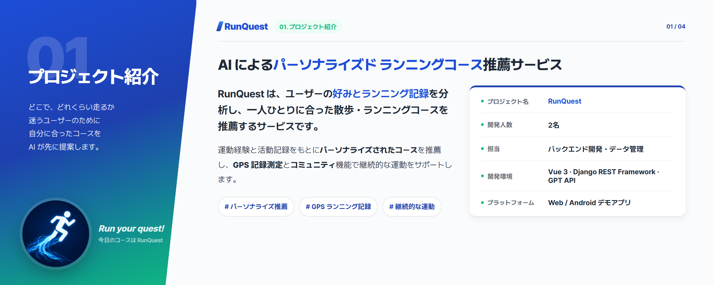
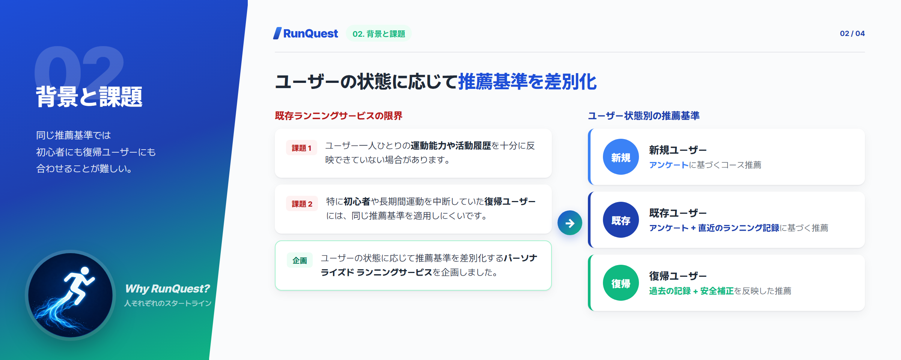
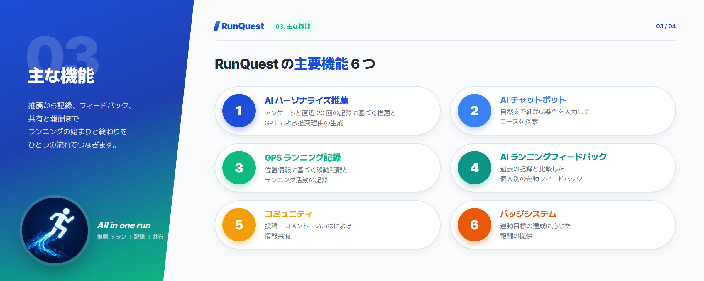
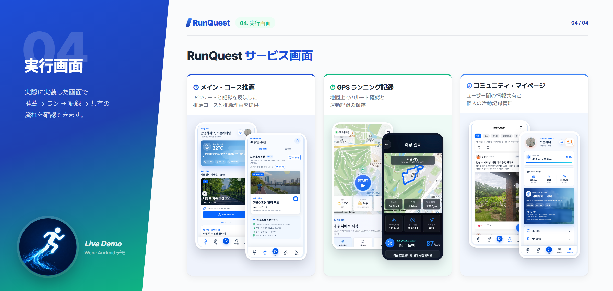
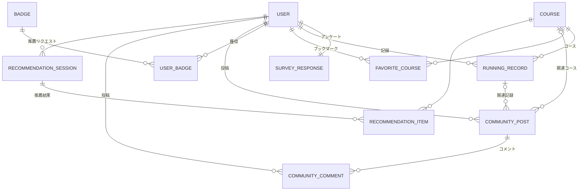

# 🏃 RunQuest — AI によるパーソナライズド ランニングコース推薦サービス

> **どこで、どれくらい走るか迷うユーザーのために、AI が先にコースを提案します。**
> ユーザーの好みとランニング記録を分析し、一人ひとりに合った散歩・ランニングコースを推薦するサービスです。

| 項目 | 内容 |
|---|---|
| 開発期間 | 2026.05 ~ 2026.06 |
| 種別 | チーム開発 |
| 担当 | バックエンド開発・データ管理 |
| 主な機能 | パーソナライズ推薦 · GPS ランニング記録 · コミュニティ |
| 主な技術 | Vue 3 · Django REST Framework · GPT API · Kakao Maps |
| プラットフォーム | Web / Android デモアプリ |

> 本ドキュメントは日本語話者向けに作成したポートフォリオ資料です。アプリ自体の画面表示は韓国語のままです。

## 01. プロジェクト紹介

## 02. 背景と課題

## 03. 主な機能

## 04. 実行画面

## 05. 担当役割

### チョ・ギュホン — バックエンド / データ管理

- Django REST Framework による REST API の開発
- 会員情報およびランニング記録に関するデータ処理
- ユーザーアンケート、コース、コミュニティデータの管理
- データベースの ERD 設計とモデリング
- フロントエンドとバックエンドの API 連携
- GPS 記録および AI 推薦機能のサーバー連携サポート

### チェ・サンジン — フロントエンド / AI

- Vue 3 による UI およびフロントエンド開発
- AI 推薦アルゴリズムの設計
- GPT API を用いた推薦・フィードバック機能の実装

## 06. 技術スタックと選定理由

| 技術 | 選定理由 |
| --- | --- |
| Vue 3 / Pinia | コンポーネントベースの UI 開発と状態管理 |
| Django REST Framework | Python ベースの REST API 開発とデータモデル管理 |
| OpenAI GPT API(OpenAI 互換 LLM API) | 推薦理由とランニングフィードバックの自然文生成 |
| Kakao Maps API | 地図の可視化と位置情報ベースのサービス実装 |
| Capacitor | 既存の Vue Web サービスをモバイルアプリへ変換 |
| ngrok | ローカルサーバーへの外部アクセスとモバイルデモ環境の構築 |

## 07. 技術実装

### 1) パーソナライズド推薦アルゴリズム

ユーザーを新規・既存・復帰の 3 つの状態に分類し、状態ごとに異なる推薦基準を適用しました。

| 区分 | 推薦基準 |
| --- | --- |
| 新規 | アンケート結果のスコア化 |
| 既存 | アンケート + 直近 20 回の記録 + 位置情報 |
| 復帰 | アンケート + 過去の記録 + 安全補正 |

推薦ロジックによって適切なコースを選定し、GPT API を活用して推薦理由を自然文で生成しました。

### 2) REST API とデータベース

Django REST Framework を用いて、ユーザー・ランニング記録・コース・コミュニティのデータを管理する API を開発しました。

主なデータモデルは以下のとおりです。

- **User / SurveyResponse**: ユーザー情報と運動傾向
- **Course / RunningRecord**: コース情報と運動記録
- **RunningRecord.ai_feedback**: 運動結果に対する AI フィードバック
- **CommunityPost / CommunityComment**: コミュニティ活動

ERD によって、ユーザーとランニング記録、コース、投稿の関係を定義しました。

ER 図の全体とフィールド定義は [docs/ERD.md](docs/ERD.md) で確認できます。

### 3) Web・モバイル連携

Vue で開発した Web サービスを Capacitor で Android アプリの形に変換しました。

開発用 PC で動作する Django サーバーを ngrok で外部に公開し、実際のスマートフォンでも機能をデモしました。

ただし、クラウドへのデプロイや正式なアプリ配布までは行っていません。

## 08. トラブルシューティング

### 1) フロントエンド–バックエンドの API 連携問題

- **問題**: フロントエンドとバックエンド間の API 通信で、データを正常にやり取りできない状況が発生しました。
- **分析と解決**: API のリクエスト・レスポンス構造と CORS 設定を確認し、フロントエンドとバックエンドの接続環境を調整しました。
- **学んだこと**: API の機能実装だけでなく、クライアントとサーバーのリクエスト形式、レスポンス構造、ネットワーク環境をあわせて考慮する必要があることを学びました。

### 2) Web とモバイルアプリの実行環境の違い

- **問題**: Web で動作していた機能が、Android アプリ環境では正常に動作しませんでした。
- **分析と解決**: ローカルサーバーへのアクセス方法とネットワーク設定を確認し、ngrok を利用して外部ネットワークからも開発サーバーにアクセスできるデモ環境を構築しました。
- **学んだこと**: Web とアプリのネットワーク環境の違いを理解し、デプロイ環境を考慮したサーバー設計の必要性を実感しました。

## 09. 学んだことと振り返り

### 学んだこと

- Django REST Framework を用いた REST API 開発
- Vue 3 フロントエンドとバックエンド間のデータ連携
- ERD モデリングとリレーショナルデータ設計
- GPT API を活用した AI 機能の連携構造の理解
- GPS、Kakao Maps API、Capacitor を活用したサービス実装の経験

### 振り返り

本プロジェクトを通じて、Web サービスの企画からデータベース設計、API 開発、フロントエンド連携まで、開発の一連の流れを経験しました。

特に API 連携やモバイルデモ環境で発生した問題を解決する中で、機能開発だけでなく、システム間の連携や実行環境への理解が重要であることを学びました。

## 10. 出典とライセンス

### 参考資料と外部サービス

- [Kakao Maps API](https://developers.kakao.com/docs/ko/kakaomap/common) — 地図および位置情報ベースの機能
- [OpenAI API](https://developers.openai.com/api/docs) — AI による推薦理由とフィードバックの生成(OpenAI 互換エンドポイント経由)
- コースデータと画像 — コースのルートはチームで用意した GPX ファイルと独自に設計した座標で構築し、コース・投稿の写真やイラストは生成 AI でチームが制作しました。実行画面キャプチャに含まれる地図タイルは Kakao Maps の著作物です。

### ライセンス

本プロジェクトは教育およびポートフォリオ目的で制作しました。

本リポジトリは**ポートフォリオの閲覧目的でのみ公開**しており、ソースコード・文書・画像の複製、改変、再配布、および他のプロジェクト・課題・商用目的での使用は許可していません。オープンソースライセンスは適用されません。詳細は [LICENSE](LICENSE) をご覧ください。
