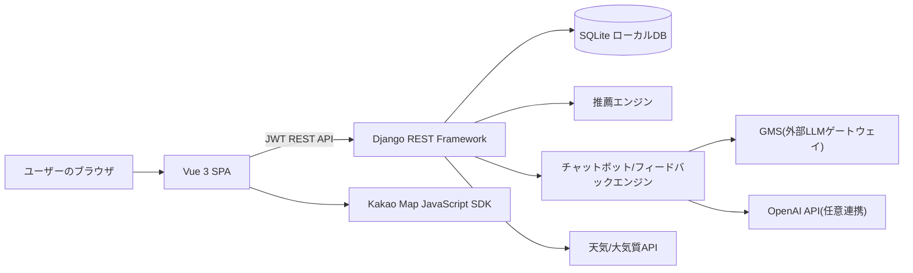

# RunQuest アーキテクチャ

RunQuest は Vue SPA フロントエンドと Django REST Framework バックエンドを分離した構成です。フロントエンドは画面表示・地図・GPS 追跡・状態管理を担当し、バックエンドは認証・データ検証・推薦計算・記録保存・コミュニティ API を担当します。

## 全体構成

## 役割分担

| 領域 | 役割 |
| --- | --- |
| Vue | 画面レンダリング、ルーティング、Pinia による状態管理、地図表示、GPS 取得 |
| Django | 認証、権限、モデル検証、API 応答、推薦計算、コミュニティ処理 |
| SQLite | ローカルデモ用データ保存 |
| Kakao Map | コース経路とランニング位置の可視化 |
| GMS/OpenAI | チャットボット応答とランニングフィードバック文の生成補助 |

## 推薦フロー

1. ユーザーがアンケートを完了する。
2. 位置情報の権限がある場合は現在座標も併せて送信する。
3. サーバーがユーザーの状態を「新規」「既存」「復帰」ユーザーに分類する。
4. アンケートスコア、直近のランニング記録、位置情報との距離、安全補正を組み合わせてコーススコアを計算する。
5. 上位 7 コースを推薦セッションに保存する。
6. ユーザーは現在の推薦を確認するか、次の推薦へ進むことができる。

## ランニング記録フロー

1. ユーザーがコース、または自由ランニングを選択する。
2. GPS モードはブラウザの位置情報をリアルタイムに取得し、シミュレーションモードはコース座標を時間経過に応じて補間する。
3. 進行中の座標と時刻はサーバーに一時保存される。
4. 終了時に距離・時間・ペース・カロリー・トラックポイントが確定する。
5. 移動距離が 100m 未満の記録は保存しない。
6. 自由ランニングの記録は、完了後にユーザーコースとして保存できる。

## コミュニティフロー

コミュニティ投稿は一般投稿、コース共有、ランニング記録共有のいずれにも対応します。一覧 API はレンダリング速度を優先し、画像の原本や詳細な nested データを除外し、詳細ページで必要なデータを取得する構成にしています。

## デプロイ構成

| 構成要素 | 説明 |
| --- | --- |
| `frontend/Dockerfile` | Vite のビルド成果物を Nginx で配信 |
| `backend/Dockerfile` | Django アプリを Gunicorn で実行 |
| `docker-compose.yml` | ローカルコンテナ実行のサンプル構成 |
| HTTPS | 実際の GPS 利用に必須 |
