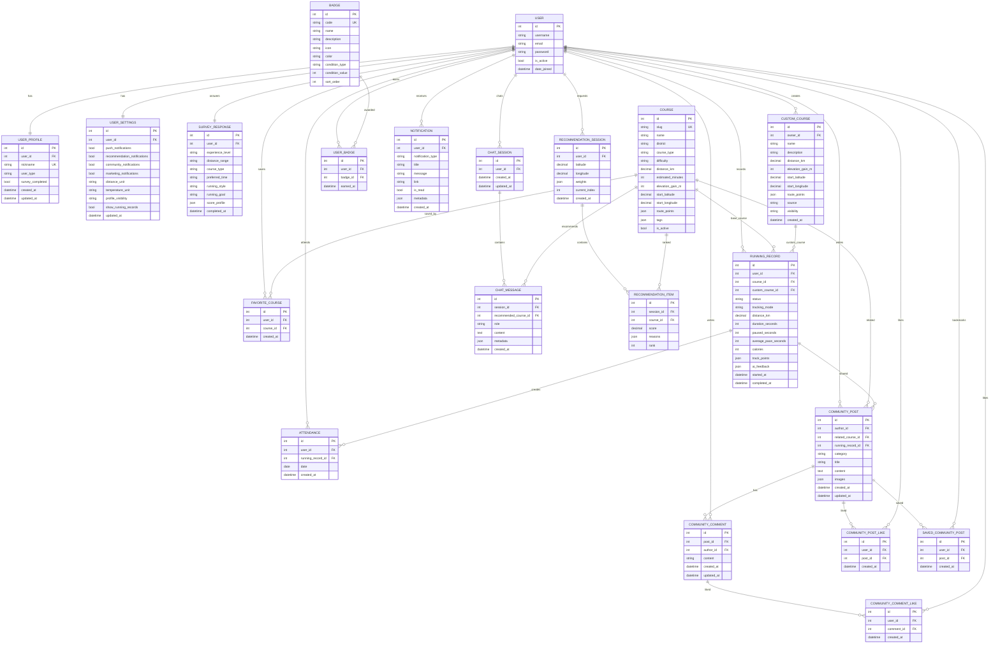

# RunQuest ERD

本ドキュメントは `backend/core/models.py` を基にした論理 ERD です。Django 標準の認証テーブルは `USER` として簡略化して表現しています。

## 全体 ERD

## 設計メモ

| 項目 | 説明 |
| --- | --- |
| 基本コースとユーザーコースの分離 | DB fixture ベースのコースは `Course`、ユーザーが作成したコースは `CustomCourse` で管理します。 |
| コース削除時の保護 | ランニング記録・投稿のコース FK は `SET_NULL` を使用し、記録自体を保護します。 |
| ランニング記録 | GPS/シミュレーションモードを `tracking_mode` で区別し、実際の移動座標は `track_points` に保存します。 |
| コミュニティの最適化 | 投稿・コメント・いいね・保存の関係に検索用インデックスを追加しています。 |
| 推薦セッション | 推薦結果を `RecommendationSession` と `RecommendationItem` に保存し、次の推薦へ進むフローを支えます。 |
| チャットボット | セッションとメッセージを分離し、メッセージごとに推薦コースを任意で紐づけます。 |
